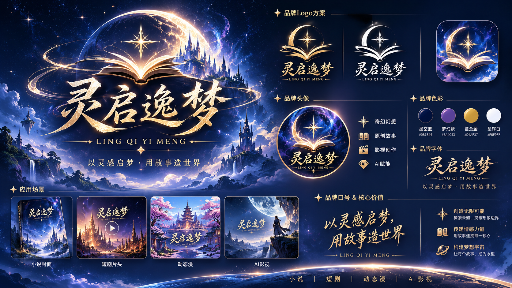

# icoolkj-expert
AI创艺坊｜AI 创作专家与 Skill 能力仓库
> 面向网文、短剧 IP 全链路创作的 WorkBuddy 专家与 Skill 能力项目

> 品牌说明：AI创艺坊是产品品牌；灵启逸梦是小说创作笔名，不作为本商业产品的品牌名称。

官网：https://icoolkj.com  

## 🧩 定位说明
专家 = 业务角色Agent；Skill = 可复用能力单元
一个专家可以挂载多个Skill，同一个Skill支持多专家复用，实现IP创作流水线协同。

## 👥 专家清单
| 专家名称 | 核心职责 | 交付物 |
| ---- | ---- | ---- |
| 灵启·总编策划官 | 项目决策、选题立项 | IP项目策划案 |
| 灵启·世界观架构师 | 世界规则、势力、力量体系 | 世界观设定集 |
| 灵启·小说主笔 | 长篇小说创作、章节续写 | 小说正文 |
| 灵启·短剧编剧 | 网文转短剧、剧本标准化 | 短剧成片剧本 |
| 灵启·影视导演 | 剧本影视化、镜头设计 | 分镜脚本、导演阐述 |
| 灵启·AI视觉设计师 | 角色、场景美术资产生成 | 角色立绘、场景素材、绘图Prompt |
| 灵启·故事审校官 | 剧情逻辑、人设、时间线校验 | 审校报告、bug修复建议 |
| 灵启·IP运营官 | IP包装、传播、商业化方案 | IP运营策划方案 |

> 8 位专家的官方头像按 01–08 编号一一对应，存放在各自的 `avatars/` 下，
> 由 `.codebuddy-plugin/plugin.json` 的 `avatar` 字段按带编号的文件名关联。
> 展示页与编号映射见 [`assets/expert-avatars/`](assets/expert-avatars/README.md)。
>
> 8 份专家 README 由 [`scripts/build_expert_readmes.py`](scripts/build_expert_readmes.py) 统一生成，
> 标题、头像、使用示例均取自各 `plugin.json`；改内容请改脚本后重跑，避免逐份手改再次走样。

## 🛠️ Skill清单（第一批10个核心Skill）
| 编号 | Skill名称 | 领域 |
| ---- | ---- | ---- |
| S01 | 原创IP项目策划 Skill | 项目策划 |
| S02 | 故事世界观构建 Skill | 世界观 |
| S03 | 长篇小说创作 Skill | 小说 |
| S04 | 小说章节续写与连续性 Skill | 小说 |
| S05 | 小说转短剧改编 Skill | 短剧 |
| S06 | 短剧剧本标准化 Skill | 短剧 |
| S07 | 影视分镜设计 Skill | 导演 |
| S08 | AI角色与场景资产设计 Skill | 视觉 |
| S09 | 故事逻辑与连续性审校 Skill | 审校 |
| S10 | IP商业运营策划 Skill | 运营 |

### 专家 ↔ Skill 映射关系
| 专家 | 绑定Skill |
| ---- | ---- |
| 灵启·总编策划官 | S01、S10 |
| 灵启·世界观架构师 | S02 |
| 灵启·小说主笔 | S03、S04 |
| 灵启·短剧编剧 | S05、S06 |
| 灵启·影视导演 | S07 |
| 灵启·AI视觉设计师 | S08 |
| 灵启·故事审校官 | S09 |
| 灵启·IP运营官 | S10 |

## 📂 目录结构
```text
icoolkj-expert/
├── experts/                # 8 位专家角色配置
│   ├── lingqi-ai-visual-designer/        # 灵启・AI 视觉设计师
│   ├── lingqi-chief-editor/              # 灵启・总编策划官
│   ├── lingqi-film-director/             # 灵启・影视导演
│   ├── lingqi-ip-operations-officer/     # 灵启・IP 运营官
│   ├── lingqi-novel-writer/              # 灵启・小说主笔
│   ├── lingqi-shortdrama-writer/         # 灵启・短剧编剧
│   ├── lingqi-story-reviewer/            # 灵启・故事审校官
│   └── lingqi-worldbuilding-architect/   # 灵启・世界观架构师
├── skills/                 # 10 个 Skill 能力包
│   ├── ai-character-environment-asset-design/     # 角色与场景资产设计
│   ├── ai-novel-writing-studio/                   # 长篇小说创作
│   ├── ai-short-drama-adaptation-studio/          # 小说转短剧改编
│   ├── cinematic-storyboard-design/               # 影视分镜脚本设计
│   ├── ip-commercial-operations-planning/         # IP商业化运营策划
│   ├── novel-continuity-and-continuation/         # 小说剧情续写与连贯性维护
│   ├── original-ip-project-planning/              # 原创IP项目策划
│   ├── short-drama-script-standardization/        # 短剧剧本标准化处理
│   ├── story-logic-and-continuity-review/         # 故事逻辑审校
│   └── story-worldbuilding/                       # 世界观设定搭建
├── assets/
│   ├── expert-avatars/     # 8 位专家头像展示页、总览图与编号映射
│   └── skill-icons/        # 12 枚 Skill 矢量图标、展示页与生成脚本
├── scripts/                # 专家 README 统一生成脚本
├── docs/                   # 工作流、规范文档
├── LICENSE
└── README.md
```

## 📜 版权与授权

详细说明见 [LICENSE](./LICENSE) 与 [docs/LICENSING.md](./docs/LICENSING.md)。
作者：icoolkj  
产品品牌：AI创艺坊；灵启逸梦为独立小说创作笔名。  
官网：https://icoolkj.com  
联系：icoolkj@163.com / QQ：594047667  

授权协议：**CC BY-NC-SA 4.0**
- ✅ 个人学习、自用创作、二次修改衍生
- ✅ 衍生作品必须沿用 CC BY-NC-SA 4.0 协议开源
- ❌ 禁止商用、打包售卖、付费服务、商业接单
- ✅ 分发、改编必须标注原项目来源

> 协议官方地址：https://creativecommons.org/licenses/by-nc-sa/4.0/
