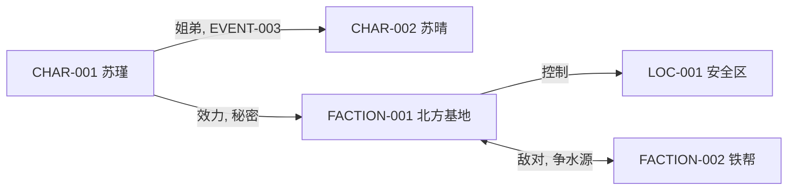

# 07 世界关系图谱与知识模型

## 1. 为什么需要图谱

设定集是"按条目组织的"，而故事需要"按关系组织的"。同一个设定，在档案里是 CHAR-001，在剧情里是"某人的姐姐""某势力的叛徒""某事件的唯一幸存者"。

图谱的作用：让这三层身份同时可见，避免写着写着人物失去位置。

## 2. 实体类型与最小字段

| 类型 | 前缀 | 最小字段 |
|---|---|---|
| 世界背景 | WORLD | 名称、核心差异点、适用范围 |
| 规则 | RULE | 内容、代价、限制 |
| 文明 | CIV | 压力来源、制度类型、价值观 |
| 势力 | FACTION | 目标、资源、弱点 |
| 人物 | CHAR | 目标、恐惧、所属 |
| 地点 | LOC | 位置、归属、功能 |
| 事件 | EVENT | 时间、结果、参与者 |
| 物品/资源 | ITEM | 来源、稀缺度、功能与代价 |
| 时间节点 | TIME | 绝对时间、标志事件 |

## 3. 关系类型词表

统一用词，避免"师父/老师/引导者"混用导致检索混乱。

| 类别 | 关系词 | 说明 |
|---|---|---|
| 血缘 | 父子、母子、兄弟、姐妹、叔侄、表亲 | 必须注明是否亲生/是否知情 |
| 师徒 | 授业、传承、背叛师门 | 注明传授内容 |
| 权力 | 上下级、统属、效忠、附庸 | 注明义务与交换 |
| 利益 | 交易、债主、雇佣、合作、垄断 | 注明标的物 |
| 敌对 | 仇敌、宿敌、竞争、通缉 | 注明起因事件 |
| 情感 | 恋人、旧情、暗恋、亲情替代 | 注明当前状态 |
| 认知 | 崇拜、误解、误认、冒充 | 注明信息差 |
| 空间 | 驻守、控制、通道、封锁 | 注明是否实际控制 |
| 规则 | 掌握、受制、免疫、禁忌 | 引用 RULE 编号 |
| 历史 | 参与、目睹、幸存、制造 | 引用 EVENT 编号 |

## 4. 关系记录的七个字段

| 字段 | 说明 | 缺失后果 |
|---|---|---|
| 主体 | 起点实体编号 | 关系无法定位 |
| 关系类型 | 来自第 3 节词表 | 无法聚合 |
| 对象 | 终点实体编号 | 同上 |
| 依据 | 因何事成立 | 读者觉得"凭什么" |
| 生效时间 | 何时开始 | 时间线错乱 |
| 当前状态 | 有效/紧张/破裂/秘密 | 人物行为与关系不符 |
| 来源 | 用户原始/专家建议/正文已写 | 无法追溯 |

## 5. 表格表达（默认方式）

### 5.1 实体关系表

| 主体 | 类型 | 对象 | 依据 | 生效 | 状态 | 来源 |
|---|---|---|---|---|---|---|
| CHAR-001 | 姐弟 | CHAR-002 | EVENT-003 中父母双亡后相依 | 元年+15 | 有效/紧张 | 已确认 |
| CHAR-001 | 效力 | FACTION-001 | 以情报换庇护 | 元年+22 | 秘密 | 专家建议 |

### 5.2 人物立场矩阵

比单线关系更实用，能一眼看出阵营分布。

| 人物 \ 势力 | FACTION-001 | FACTION-002 | FACTION-003 |
|---|---|---|---|
| CHAR-001 | 效忠（表面） | 暗中交易 | 敌对 |
| CHAR-002 | 敌对 | 中立 | 效忠 |

**纪律**：矩阵中的空格是"未定义"，不是"无关系"。未定义项要显式标为 `未定`，否则后续会当不存在处理。

## 6. Mermaid 表达（仅在需要可视时使用）



使用规则：

- 节点标签统一写 `编号 + 名称`，便于对照表格。
- 边标签写 `关系类型, 依据`。
- 单张图节点控制在 20 以内；超出则按势力拆分成多张。
- 图只作为补充，**表格是权威版本**。

## 7. 信息可见性模型（易被忽略但极关键）

这是世界观与悬疑/权谋类故事的必需品：不是"世界有什么"，而是"谁在第几阶段知道什么"。

### 7.1 认知矩阵

| 信息 | 真相 | CHAR-001 认为 | CHAR-002 认为 | FACTION-001 认为 | 读者已知 |
|---|---|---|---|---|---|
| 灾变来源 | 实验室泄漏 | 天罚 | 天罚 | 人为事故（隐瞒） | 未知 |
| 父亲死因 | 被处决 | 意外 | 被 CHAR-001 害死 | 无关 | 第 2 阶段 |

### 7.2 三条纪律

1. **每个重要信息必须有"谁误以为什么"**。所有人都正确知道一切的世界，没有阴谋可言。
2. **人物的行动只能基于他已知的信息**。这是防止"人物突然全知"的唯一办法。
3. **读者的认知进度单独一列**。读者知道得比主角多（悬念）或少（惊奇），是两种不同效果，必须有意设计。

## 8. 图谱构建流程

```
1. 列实体清单（按前缀分类，编号连续）
2. 抽关系（从人物档案、势力档案、事件表中抽取，不凭印象编）
3. 补依据（每条关系必须挂到一个 EVENT 或具体交换）
4. 标注状态与来源
5. 检查孤岛（无任何关系的实体，要么补关系，要么降级为背景）
6. 检查密度（关系数 / 实体数，低于 0.8 说明连接不足）
7. 输出图谱与矩阵
```

## 9. 常见错误

| 错误 | 表现 | 修复 |
|---|---|---|
| 为画图编关系 | 图谱很漂亮，剧情里从未体现 | 删掉无依据的边 |
| 全员互联 | 每个人都认识每个人 | 保留必要的陌生人 |
| 只连主角 | 所有关系都经过主角 | 补充配角之间的关系（这是世界感的来源） |
| 关系无变化 | 从头到尾状态不变 | 补变化节点 |
| 类型混用 | 同一关系有两种叫法 | 统一词表 |

**最重要的补强**：至少写 3 条**与主角无关**的关系（两个配角之间的、两个势力之间的）。这是世界"自己活着"的证据。
